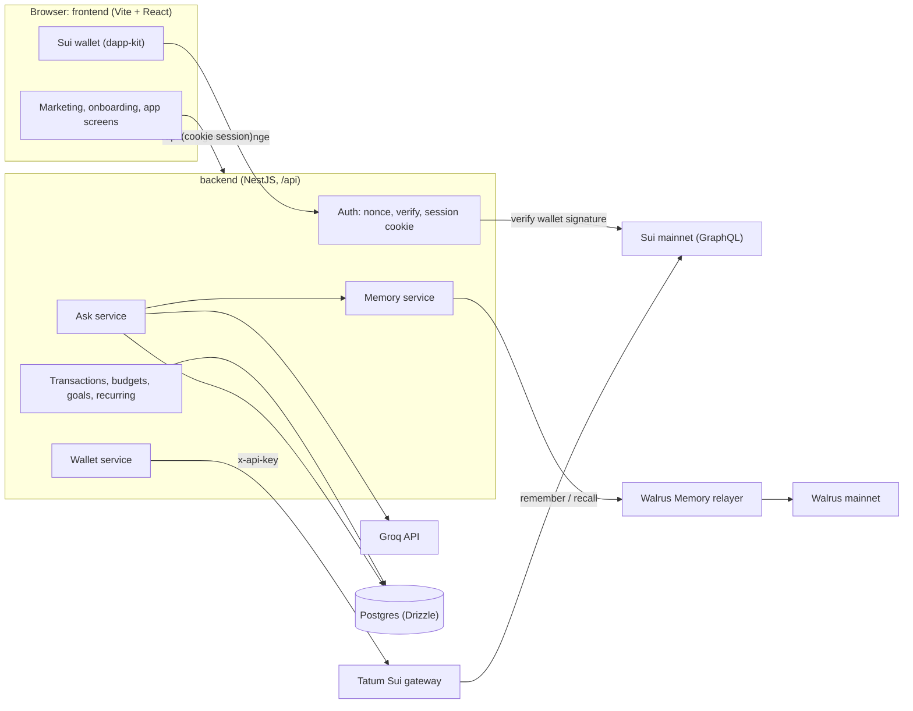

<p align="center">
  
</p>

<h1 align="center">Sovra</h1>

<p align="center"><strong>The money app that remembers your goals.</strong></p>

<p align="center">
  A personal finance app that learns your goals, limits and decisions, keeps them in a memory vault on Walrus, and uses them every time you check a budget or ask a question.
</p>

<p align="center">
  Built for the <a href="https://tatum.io/hackathon/total-recall">Tatum x Walrus "Total Recall" hackathon</a>, Consumer Finance Apps track.
</p>

---

## Contents

- [Why Sovra](#why-sovra)
- [What it does](#what-it-does)
- [How it uses Walrus, Tatum and Sui](#how-it-uses-walrus-tatum-and-sui)
- [Architecture](#architecture)
- [Tech stack](#tech-stack)
- [Repository layout](#repository-layout)
- [Getting started](#getting-started)
- [Configuration](#configuration)
- [Frontend routes](#frontend-routes)
- [Backend API](#backend-api)
- [Design system](#design-system)
- [Project status](#project-status)
- [Hackathon checklist](#hackathon-checklist)
- [License](#license)

## Why Sovra

Most money apps forget you the moment you close them. You set a budget, explain a big month, correct the same merchant again, and next time the app starts from zero.

Sovra keeps that context. Every goal, limit, category correction and decision becomes a memory written in plain words. Before Sovra shows a budget warning or answers a question, it recalls what you told it. Advice gets more personal every week instead of resetting every login.

**Example.** In September you tell Sovra you're saving for a $1,200 laptop and want to keep entertainment under $100. In October, Spotify and Netflix are about to renew. Sovra counts both renewals before they land, sees entertainment would end the month at $111, and offers to pause Netflix so the laptop fund stays on track. When you choose, the decision itself is remembered for next time.

## What it does

| Area | What you get |
|---|---|
| **Overview** | Total balance across bank accounts and USDC on Sui, a 30-day trend, what Sovra remembers, live budget status and a goal tracker |
| **Transactions** | Imported transactions with search and filters. Change a category and Sovra asks "Always file Amazon under business supplies?" and learns the rule |
| **Budgets** | Monthly limits that count scheduled renewals as hatched segments before they hit, plus suggestions based on your history. When a budget is heading over, **What should I cut?** has the AI pick which renewals to pause and which habits to skip, with the saving for each, and it leaves alone anything you told Sovra matters to you |
| **Goals** | Savings goals with progress, weekly amounts and target dates |
| **Recurring** | Bills and subscriptions found in your transactions, with reminders and Pause/Resume. Pausing really frees the money in your budgets |
| **Memory** | Every memory Sovra keeps, in plain words with the key phrase highlighted. Filter by type and forget anything, with Undo |
| **Ask Sovra** | Plain-language questions answered from your numbers and memories, showing which memories the answer used |
| **Accounts and top-up** | Your Sui wallet read live through Tatum, CSV statement import, and a USDC top-up flow with QR code and deposit watching |
| **Onboarding** | Four short steps (name, money sources, a goal with payday, one spending limit) with a live panel showing what Sovra will remember |

Sovra is **read-only**. It never moves money, never holds funds and never asks for a bank password.

## How it uses Walrus, Tatum and Sui

### Walrus Memory: the learning loop

Goals, limits, corrections, decisions and preferences are stored as memories with [Walrus Memory](https://docs.wal.app/walrus-memory) on Walrus mainnet. Each user has their own namespace (`sovra-<address>`).

- **Write:** onboarding answers, "remember this category", accepted or rejected budget suggestions, and pause or keep decisions all call `remember()`.
- **Read:** Ask Sovra and the budget insights call `recall()` before answering, and the answer lists the memories it used.
- **See and control:** the Memory page lists everything in plain words. Forgetting stops Sovra from using a memory immediately. The encrypted copy on Walrus stays until its storage period ends, because the SDK has no delete; the privacy policy says so.

### Tatum: live onchain data

Sovra reads the user's USDC balance and transfers on Sui mainnet through Tatum's Sui gateway (`https://sui-mainnet.gateway.tatum.io/graphql`, `x-api-key` header). The top-up flow watches the same balance to confirm a deposit arrived. USDC is Circle's native coin type `0xdba34672e30cb065b1f93e3ab55318768fd6fef66c15942c9f7cb846e2f900e7::usdc::USDC`.

### Sui wallet sign-in

Users connect any Sui wallet through `@mysten/dapp-kit-react`: browser extensions found through the Wallet Standard, or the Slush web wallet, which needs no install. To start a backend session, the wallet signs a one-time challenge and the backend verifies it with `verifyPersonalMessageSignature`. Sovra never asks the wallet to approve a transaction.

### Groq: answers and categorization

Ask Sovra and CSV categorization run on Groq's OpenAI-compatible API. By default `openai/gpt-oss-120b` writes answers and `openai/gpt-oss-20b` categorizes merchants with strict JSON output. Answers are grounded in the user's own budgets, goals, transactions, bills and recalled memories, and the prompt forbids investment, tax or legal advice.

## Architecture



Secrets (Tatum key, Walrus Memory delegate key, Groq key, session secret) live only on the backend. The frontend needs no keys at all.

## Tech stack

| Layer | Tools |
|---|---|
| Frontend | Vite 8, React 19, TypeScript, React Router, Tailwind CSS v4, lucide-react, qrcode.react, Hanken Grotesk |
| Sui | `@mysten/dapp-kit-react` (wallet connect), `@mysten/sui` |
| Backend | NestJS, TypeScript, zod, Drizzle ORM, Postgres (`postgres-js`), JWT session cookie |
| Integrations | Walrus Memory (`@mysten-incubation/memwal`), Tatum Sui gateway, Groq |
| Tooling | oxlint, tsc, drizzle-kit |

## Repository layout

```
.
├── frontend/            Vite + React app
│   ├── public/brand/    Logo, mark and app icon (SVG)
│   └── src/
│       ├── pages/       Marketing, auth, onboarding, app screens, legal, 404
│       ├── components/  Shell (sidebar, top bar), UI kit, feature components
│       └── lib/         Auth and data stores, API client, formatting, demo data
├── backend/             NestJS API (see backend/README.md)
│   ├── src/             One module per area: auth, wallet, memory, ai, ask, ...
│   └── drizzle/         SQL migrations
├── design/              Design explorations: colour directions, logo options
├── LICENSE
└── README.md
```

## Getting started

### Requirements

- Node.js 24 and npm
- Postgres for the backend's data routes (Neon, Supabase, Railway or local). Optional to start: the server boots without it.

### Install

```bash
git clone https://github.com/Kingvic300/Sovra.git
cd Sovra
npm run install:all
```

### Run the frontend only

The frontend works on its own with demo data, so this is the quickest way to look around.

```bash
npm run dev:frontend          # http://localhost:5173
```

Open http://localhost:5173 and choose a wallet or **Explore with a demo account**. Without a backend, every screen shows the sample story and saves changes in your browser.

### Run the full stack

```bash
cp backend/.env.example backend/.env
# Set at least SESSION_SECRET (openssl rand -hex 32). Add the other keys as you get them.

npm --prefix backend run db:migrate   # once DATABASE_URL is set
npm run dev:backend                   # http://localhost:8787/api/health

npm run dev:frontend
```

The Vite dev server proxies every `/api` request to the backend on port 8787. Once the backend has verified your session, every screen reads and saves through it.

### Scripts

| Command | What it does |
|---|---|
| `npm run install:all` | Install frontend and backend dependencies |
| `npm run dev:frontend` | Vite dev server on :5173 |
| `npm run dev:backend` | NestJS in watch mode on :8787 |
| `npm run build` | Production builds of both apps |
| `npm run lint` | Lint the frontend with oxlint |

## Configuration

### Frontend

The frontend needs no environment variables. In production, `/api` must reach the backend on the same origin (a rewrite in `frontend/vercel.json`), because the session cookie is `SameSite=Lax`.

### Backend (`backend/.env`)

| Variable | Required | Purpose |
|---|---|---|
| `SESSION_SECRET` | yes | Signs the session cookie |
| `PORT` | no | Defaults to `8787` |
| `FRONTEND_ORIGIN` | no | CORS origin. Defaults to `http://localhost:5173` |
| `DATABASE_URL` | for data routes | Postgres connection string |
| `TATUM_API_KEY` | for wallet reads | Tatum dashboard API key |
| `MEMWAL_KEY` | for memories | Walrus Memory delegate **private** key |
| `MEMWAL_ACCOUNT_ID` | for memories | Walrus Memory account ID |
| `MEMWAL_SERVER_URL` | no | Defaults to the mainnet relayer |
| `GROQ_API_KEY` | for Ask Sovra | Groq API key |
| `GROQ_MODEL` / `GROQ_FAST_MODEL` | no | Default to `openai/gpt-oss-120b` / `openai/gpt-oss-20b` |

Any integration without its key answers `503 {"error":{"code":"not_configured"}}` and the server keeps running. `GET /api/health` shows which ones are configured.

> Never put secret keys in `frontend/.env*`. Anything prefixed `VITE_` is bundled into the browser.

## Frontend routes

| Route | Page |
|---|---|
| `/` | Home |
| `/how-it-works`, `/security`, `/faq` | Marketing pages |
| `/signin`, `/signup` | Email and password, Sui wallet, or demo account |
| `/onboarding` | Four-step setup |
| `/app` | Overview |
| `/app/transactions`, `/app/budgets`, `/app/goals`, `/app/recurring` | Money screens |
| `/app/accounts` | Sui wallet, top-up, CSV import |
| `/app/memory` | What Sovra remembers |
| `/app/ask` | Ask Sovra |
| `/terms`, `/privacy` | Legal |
| anything else | 404 |

Route protection is switched off for now so every screen can be opened directly. Turn it on with `ROUTE_GUARDS_ENABLED` in `frontend/src/lib/config.ts`.

## Backend API

All routes are under `/api` and return errors as `{ "error": { "code", "message" } }`. Everything except `health` and `auth/*` needs the session cookie. Full details are in [backend/README.md](backend/README.md).

| Area | Endpoints |
|---|---|
| Health | `GET /health` |
| Auth | `POST /auth/nonce`, `POST /auth/verify`, `POST /auth/signup`, `POST /auth/login`, `POST /auth/demo`, `POST /auth/logout` |
| Profile | `GET /me`, `PUT /me/profile` |
| Wallet | `GET /wallet/balance`, `GET /wallet/transactions`, `GET /wallet/deposit` |
| Memories | `GET /memories`, `POST /memories`, `POST /memories/recall`, `DELETE /memories/:id` |
| Transactions | `GET /transactions`, `POST /transactions/import`, `PATCH /transactions/:id` |
| Budgets | `GET /budgets`, `PUT /budgets/:category`, `DELETE /budgets/:category` |
| Goals | `GET /goals`, `POST /goals`, `PATCH /goals/:id`, `DELETE /goals/:id` |
| Recurring | `GET /recurring` |
| Ask | `POST /ask` |

## Design system

The "Porcelain" direction: cool, bright and calm, with a highlighter mark on everything Sovra remembers.

| Token | Value | Use |
|---|---|---|
| Porcelain | `#EBF0F6` | Page background |
| Card | `#FFFFFF` | Surfaces |
| Ink | `#0F1B33` | Text, dark panels |
| Muted | `#56657E` | Secondary text |
| Cobalt | `#2340D0` | Primary actions, brand |
| Highlighter | `#FFE15A` | Remembered facts |
| Gain / Caution / Over | `#0E7D57` / `#B76E00` / `#C9323A` | Money states |

Type is Hanken Grotesk throughout, with tabular figures for amounts. The logo is a squared "ledger S" drawn as one continuous line; the app icon is the white S on a navy tile with a cobalt signal dot. Explorations are in [`design/`](design/).

## Project status

This is a hackathon build. What works today, and what is still being connected:

- **Done:** every screen and flow in the frontend; the backend API with Tatum, Walrus Memory, Groq, CSV import, learned category rules, recurring detection and wallet signature checks; toasts, validation and error handling throughout.
- **Connected:** once the backend verifies the session, the app reads and saves accounts, transactions, budgets and budget suggestions, goals, memories, recurring charges (including pause and resume), reminders, Ask history, and data export and account deletion through it. The demo account gets the sample story without a reachable backend; a real account shows empty screens instead of sample data.
- **Browser only:** which overview insights you've answered is kept per address in the browser.
- **End-to-end checks:** see [docs/e2e.md](docs/e2e.md) for the last recorded run and the manual checklist.

## Hackathon checklist

- [ ] Walrus Memory writing on mainnet, at least 10 memories
- [ ] Tatum Sui gateway used for onchain data
- [x] Public repo
- [ ] Working demo deployed
- [ ] Blog post: what it does, how it uses Tatum and Walrus, how it learned over time
- [ ] 2 to 3 minute demo video
- [ ] Submission form: Tatum ID, Sui address, Sui account ID, `MEMWAL_AGENT_ID`

## License

[MIT](LICENSE)
